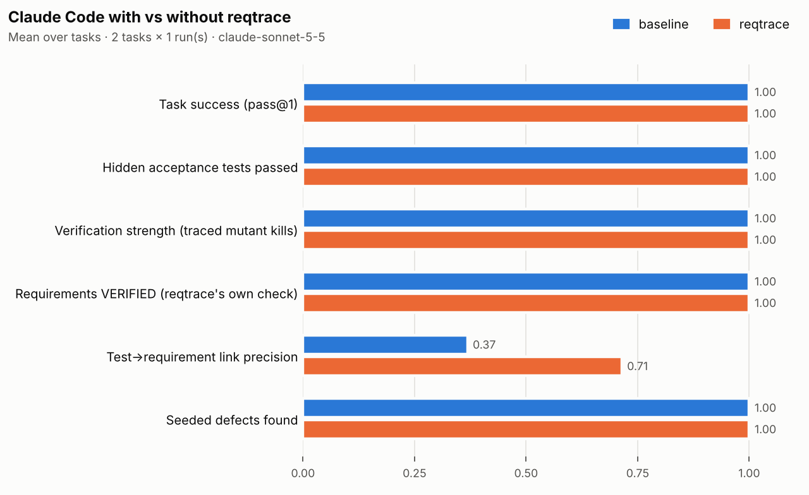

# reqtrace-mcp

**Make Claude Code prove its work.** An MCP server and Claude Code plugin that traces every change
to a requirement and every requirement to a test that *actually exercises it*. It adds an
independent reviewer that can't edit code and a sign-off that only a human can give. A benchmark
measures whether any of this helps.

> Writing software is getting cheap; trusting it isn't.

Built with Claude Code. Inspired by public safety-critical practice (DO-178C-style
traceability, independence and structural coverage). It is **not** a qualified tool and makes
no certification claim. All examples are synthetic.

**Status:** M0–M3 complete (library, server, plugin). The M4 benchmark is built and validated,
and the pilot has run. The full benchmark results are pending.

---

## What it does

```
requirements/*.yaml ──► # implements: REQ-001 ──► @pytest.mark.verifies("REQ-001") ──► run under coverage
                                                                                          │
         human sign-off ◄── evidence report ◄── independent verifier ◄── gaps ◄──────────┘
```

| Status | Meaning |
|---|---|
| `NOT_IMPLEMENTED` | No code says it implements the requirement |
| `NOT_VERIFIED` | No test says it verifies it |
| `FAILING` | A linked test fails |
| **`WEAKLY_VERIFIED`** | Linked tests pass but **never execute the implementing code** (per-test coverage) |
| `VERIFIED` | Linked tests pass and execute the implementing code |
| `REVIEWED` | Verified, and a human approved this exact content (a sign-off goes stale if the code changes) |

Gap analysis also finds **code no requirement asked for**, dangling links, uncovered
branches, stale reviews and results that are stale since the last test run. Change impact
maps a git diff to the affected requirements, the tests to rerun, and the reviews it
invalidates. Requirement text edits and deleted functions are included.

### Why the design choices matter

- **Human-only sign-off, enforced by protocol.** `record_review` is marked
  `anthropic/requiresUserInteraction`, so Claude Code prompts on every call, in every permission
  mode. The reviewer's name and rationale come from the human by MCP elicitation. They are
  never tool arguments, so the model can't fill them in.
- **Separation of duties.** The `independent-verifier` sub-agent has no Edit, Write or Bash
  tools, and judges code against requirement text only.
- **Deterministic server.** It never calls an LLM. Every output can be reproduced and audited.
- **Safe by construction.** The only process the server starts is the repo's own
  `coverage run -m pytest`, built from config. No tool accepts a command. Paths are confined to the repo.

See [`docs/DECISIONS.md`](docs/DECISIONS.md) for the trade-offs behind each choice.

## Quickstart

Needs Python 3.10+, [uv](https://docs.astral.sh/uv/), and `pytest` and `coverage` in the
target repo's environment.

**As a Claude Code plugin** (server, skill, sub-agents and commit gate):

```bash
claude plugin marketplace add hishanparry/reqtrace-mcp   # once published on GitHub
claude plugin install reqtrace@reqtrace-mcp
```

Or, without installing, from a clone: `claude --plugin-dir /path/to/reqtrace-mcp`.

**As a plain MCP server** for any MCP client: run `uvx --from /path/to/reqtrace-mcp reqtrace-mcp`
over stdio.

**As a CLI**, for humans and CI:

```bash
pip install -e .
cd examples/altitude-alerter
reqtrace verify && reqtrace matrix && reqtrace gaps
reqtrace review ALT-001 --approve --reviewer "Your Name" --rationale "Checked boundaries"
reqtrace report            # .reqtrace/evidence/evidence.md
reqtrace gate --verify     # exit 1 if gaps exceed .reqtrace.yaml thresholds
```

The example repo seeds one of each problem. Without changing anything you get one VERIFIED,
one WEAKLY_VERIFIED (a tagged test that only checks a constant), one untested and one
unimplemented requirement, plus one unrequired function.

## MCP surface

**Tools:** `list_requirements`, `get_requirement`, `trace_matrix`, `find_gaps`,
`impact_of_change`, `run_verification`, `coverage_report`, `lint_requirements`,
`flag_requirement_issue`, `propose_links` (stored as *unconfirmed*), `record_review`
(human-only) and `evidence_report`. All return structured output; read-only tools are annotated.

**Resources:** `reqtrace://requirements`, `reqtrace://requirements/{id}`, `reqtrace://matrix`,
`reqtrace://evidence/latest`.

**Prompts:** `implement_traceably`, `independent_review`.

Built on the official Python SDK 2.x and the stateless 2026-07-28 protocol. Tested with both
2026 and 2025-era clients.

## The benchmark

`evals/` asks whether Claude Code produces **more trustworthy** work with reqtrace than
without. Both arms get the same repo, prompt, model, tools and a `CONTRIBUTING.md` describing
the annotation convention. The only difference is the plugin.

- **10 tasks** in four invented domains: battery controller, robot joint limits, thruster
  limiter and ROV depth alarm.
  - 4 implement tasks.
  - 2 requirement-change tasks.
  - 3 review tasks: one boundary defect, one missing requirement plus an unrequired
    "maintenance mode" that silences the alarm, and one clean control.
  - 1 task with conflicting requirements.
- **Deterministic graders.** Hidden acceptance tests. **Verification strength**: the agent's
  tests are run against a reference implementation and against one mutant per requirement,
  and a requirement counts only if a test *linked to it* catches its mutant. Link
  precision and recall. Unrequired code. Seeded-defect detection and false positives. Whether
  the conflict was flagged. Cost.
- **Validated before use.** `python -m evals check` proves that each reference passes, that
  each mutant is caught by its own requirement's hidden tests, and that the starting code
  fails. The grader has its own tests.

```bash
python -m evals check
python -m evals run --runs 3 --out evals/results/mvp
python -m evals report evals/results/mvp
```

### Pilot (2 tasks × 2 arms × 1 run, Claude Sonnet 5.5)

The pilot checks the plumbing. It is not a result.



Both arms solved both pilot tasks. With reqtrace, test-to-requirement links were more precise
(0.71 vs 0.37). The cost was more turns (11 vs 5.5) and about 30% more spend. In the review
task the reqtrace arm never used its tools. Full numbers:
[`evals/results/pilot/summary.md`](evals/results/pilot/summary.md).

## Limitations, honestly

- Python and pytest only. Links are at function level. Statement and branch coverage only;
  MC/DC is future work.
- Annotations are claims. reqtrace checks them with per-test coverage, but *execution is not
  assertion*: a test can run code and check nothing. The benchmark measures that with mutants.
  Mutation testing inside the tool is future work.
- `requiresUserInteraction` is a Claude Code hint. Other MCP clients may not honour it,
  though elicitation still keeps the reviewer's identity away from the model.
- The commit gate only sees commits Claude makes. `reqtrace gate --verify` works as a normal
  git pre-commit hook for humans.
- Benchmark: small synthetic tasks, so a strong model may hit a ceiling on task success. The
  pilot suggests the measurable difference is in traceability quality and cost, not in
  whether the code works.

## Repo layout

```
src/reqtrace_mcp/   core library (no MCP dependency), CLI, MCP server, pytest plugin
skills/ agents/ hooks/ .claude-plugin/   Claude Code plugin
examples/altitude-alerter/   demo repo with one of each gap
evals/              benchmark: domains, tasks, harness, graders, results
docs/               SPEC, DECISIONS (ADRs), DEVLOG
```

Licence: Apache-2.0.
