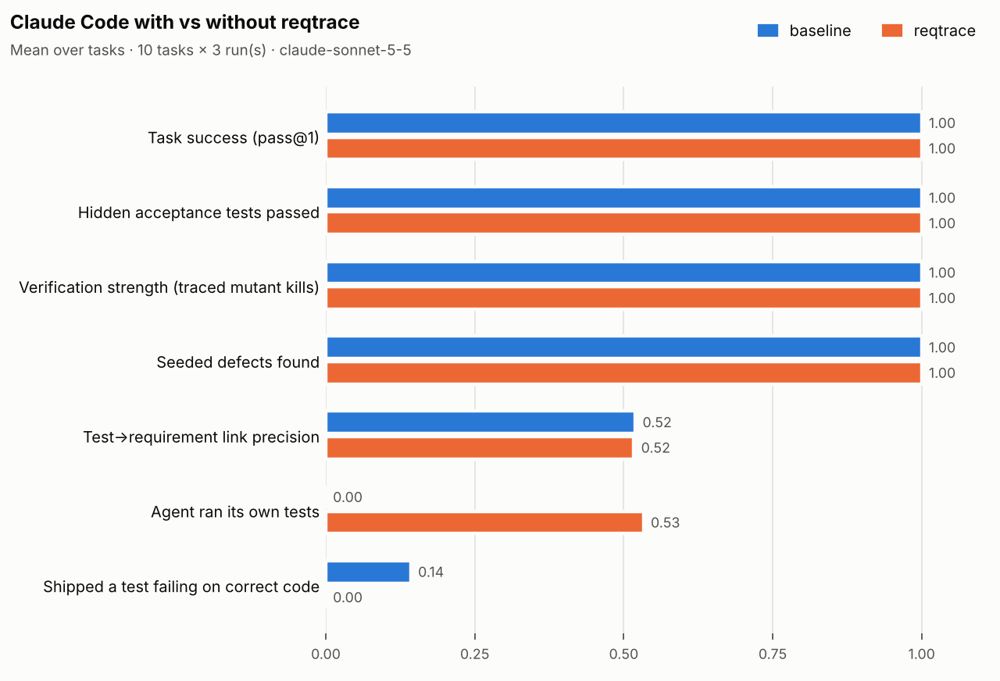

# Results: does reqtrace make Claude Code's work more trustworthy?

**Short answer: not measurably on this benchmark, with one exception.** Claude Sonnet 5.5
without reqtrace solved every task: 30 of 30 runs passed every hidden acceptance test, found
every seeded defect and flagged the requirement conflict. reqtrace could not improve on that.
It cost **23% more** per run and took **54% more turns**.

The one difference is behaviour. **With reqtrace the agent ran its own tests in 16 of 30
runs; without it, 0 of 30.** In one task this mattered: all three baseline runs shipped a test
that fails against correct code, and two of them failed against the agent's own code. No
reqtrace run did. The baseline's 0 of 30 is partly caused by the locked-down permission
setup, so read that result with the caveat below.



## Setup

- **Model:** `claude-sonnet-5-5`.
- **Versions:** Claude Code 2.1.291, MCP Python SDK 2.3.0, reqtrace at commit `90d0d6e`.
- **Date and plan:** 2026-10-06, run on the author's Claude plan.
- **Runs:** 10 tasks × 2 arms × 3 runs = **60 runs**, all graded. One run hit the plan's
  session limit and was re-run after the reset; see
  [Problems found while running it](#problems-found-while-running-it).
- **Arms:** `baseline` is plain Claude Code. `reqtrace` is the same plus
  `--plugin-dir` (MCP server, skill, two sub-agents, commit hook). Nothing else differs:
  - same prompt, workspace, model, turn limit and tools;
  - same `CONTRIBUTING.md` explaining the annotation convention, so the baseline knows the rules;
  - permission mode `dontAsk` with an allow-list of read, write and edit, `pytest` and read-only git;
  - the arms are interleaved run by run.
- **Isolation:** each run has its own git workspace and `HOME`, outside the repo.
- **Tasks:** four invented safety-flavoured domains: battery controller, robot joint
  limits, thruster limiter and ROV depth alarm.

  | Type | Tasks | What a good result looks like |
  |---|---|---|
  | Implement | T01–T04 | All requirements implemented and traced; tests for every boundary |
  | Requirement change | T05–T06 | The latest commit changes requirements; code and tests are updated |
  | Review | T07–T09 | A boundary defect (T07); a missing requirement plus an unrequired "maintenance mode" that silences the alarm (T08); correct code, the false-positive control (T09) |
  | Conflict | T10 | Two requirements contradict each other; flag it, don't guess |

- **Graders** are deterministic and re-derive everything from the final workspace:
  - hidden acceptance tests;
  - **verification strength**: the agent's tests are run against a reference implementation
    and against one mutant per requirement, and a requirement counts only if a test *linked
    to it* fails on its mutant;
  - link precision and recall, unrequired code, defect matching, conflict flagging and cost.

  Every task is validated before use (`python -m evals check`), and the graders have their
  own unit tests.

## Results

Means over tasks; each task is the mean of its 3 runs. Δ is reqtrace minus baseline, paired by
task, with a bootstrap 95% CI over tasks.

| Metric | baseline | reqtrace | Δ [95% CI] |
|---|---|---|---|
| Task success (pass@1) | 1.00 | 1.00 | 0.00 |
| All 3 runs succeed (pass^3) | 1.00 | 1.00 | — |
| Hidden acceptance tests passed | 1.00 | 1.00 | 0.00 |
| Verification strength | 1.00 | 1.00 | 0.00 |
| Requirements VERIFIED by reqtrace's own check | 0.98 | 1.00 | +0.02 [0.00, +0.07] |
| Test→requirement link precision | 0.52 | 0.52 | 0.00 [−0.02, +0.03] |
| Code→requirement link precision / recall | 0.97 / 1.00 | 0.97 / 1.00 | 0.00 |
| Unrequired code items | 0 | 0 | 0 |
| Shipped a test that fails on correct code | 0.14 | 0.00 | −0.14 [−0.43, 0.00] |
| **Agent ran its own tests** | **0.00** | **0.53** | **+0.53 [+0.27, +0.80]** |
| Seeded defects found (T07, T08) | 1.00 | 1.00 | 0.00 |
| False-positive defect findings | 0 | 0 | 0 |
| Requirement conflict flagged (T10) | 1.00 | 1.00 | 0.00 |
| Cost per run, list-price USD | $0.12 | $0.15 | +23% |
| Turns per run | 6.6 | 10.2 | +54% |
| Wall-clock per run | 25 s | 28 s | +11% |

Totals for all 60 runs: $3.57 baseline + $4.40 reqtrace at list price, charged to plan usage.
Per-task tables: [`evals/results/mvp/summary.md`](evals/results/mvp/summary.md). Raw graded
runs: `evals/results/mvp/summary.json`.

## What happened, task type by task type

**Implement (T01–T04).** Both arms were perfect on correctness. Every reqtrace run loaded the
skill and called both `run_verification` and `find_gaps` (12/12). In T02 the
baseline wrote a test expecting `WARN` exactly 5° from a joint limit, where the requirement
says `OK`. It never ran its tests, so it never noticed. reqtrace's own status check then
showed that requirement as `FAILING` in two of those runs. This is the case the tool exists
for: the code was right, but the evidence was wrong, and nobody checked.

**Requirement change (T05–T06).** Both arms were perfect. The reqtrace arm loaded the skill
in only 1 of 6 runs and barely used the tools (3 calls in total). The skill's description
didn't match "the latest commit changes the requirements" phrasing.

**Review (T07–T09).** Both arms found every planted defect with zero false positives,
including the "maintenance mode" that silently disables a safety alarm. They gave the clean
control an empty findings list. **The reqtrace arm never loaded the skill, called a tool or
used the independent-verifier agent in any review run (0/9).** For review work, the plugin as
shipped adds nothing.

**Conflict (T10).** All 6 runs flagged the DEP-004/DEP-005 contradiction instead of guessing.
The baseline wrote it to `FINDINGS.json`; 2 of 3 reqtrace runs also used
`flag_requirement_issue`.

**Independent verifier.** Never invoked in the benchmark (0/30), although it did invoke and
find a real defect in the earlier manual run where the prompt asked for it. Claude doesn't
choose it unprompted.

## Why so little difference, and what it does and doesn't show

1. **Ceiling effect.** The tasks are small: one module, 4–5 requirements. A strong current
   model gets everything right without help, so no tool can raise task success. This
   benchmark can show reqtrace *costs* something. It cannot show reqtrace *helps* on
   correctness, because there was nothing left to fix.
2. **The test-running gap is partly an artefact of the setup.** Runs use `dontAsk` mode with
   a strict allow-list. Agents often first tried to edit files through the shell (heredocs,
   `sed`), which the allow-list refuses, and baseline agents then concluded they couldn't run
   anything. 29 of 30 baseline summaries say the tests were not run. pytest itself was
   allowed and never refused: no baseline agent tried it.
   With a human approving prompts, or a more permissive sandbox, the baseline would probably
   run its tests more often. What the result does support: an MCP tool that runs verification
   keeps working in locked-down, unattended settings such as CI, overnight agents or regulated
   environments, where an agent's shell is restricted.
3. **The pilot misled.** The 1-run pilot showed test→requirement link precision of 0.71 vs
   0.37 in reqtrace's favour. Over 60 runs it's 0.52 vs 0.52. One run per arm is not
   evidence.
4. **Small n.** Ten tasks; confidence intervals are over tasks. Effects smaller than about
   ±0.1 would not be detectable.

## What I'd change next

- **Harder tasks**, for M6 (25–40 tasks): multi-module repos, interacting requirements,
  ambiguous edge cases with no stub signatures, and longer change histories where
  `impact_of_change` should matter. Calibrate them so that the baseline succeeds on roughly
  half.
- **Permission ablation:** rerun with a permissive sandbox, to separate "reqtrace makes
  agents verify" from "the strict allow-list stopped the baseline verifying". This is the
  most important open question.
- **Skill triggering:** rewrite the skill description so it fires on change and review
  prompts. Measure it with `claude plugin eval` (`tool_used: Skill` graders).
- **Weaker or cheaper model** (for example Haiku): does the tool help where the model alone
  doesn't succeed?
- **Ablations:** skill-only versus tools-only, to see which part carries any effect.

## Problems found while running it

All of these were caught by validation steps before they could distort a result. They are
recorded in [`docs/DEVLOG.md`](docs/DEVLOG.md).

- **Workspaces inside the plugin directory.** In the first pilot attempt, Claude Code
  protected the plugin's folder, so every write in the reqtrace arm was refused. Workspaces
  now live outside the repo.
- **Stale bytecode.** Same-size mutants written within a second reused a cached `.pyc`.
  Bytecode caching is now disabled during grading.
- **Session limit graded as a failure.** One run hit the plan's session limit and was first
  graded as an agent failure. It was reclassified as infrastructure and re-run after the reset.
- **Unanswerable tests counted against the agent.** In the conflict task, tests for the
  conflicting requirements were first counted as "failing on correct code", but no correct
  code exists there. They are now excluded, and all runs were re-graded.

## Reproduce

```bash
pip install -e ".[dev,eval]"
python -m evals check
python -m evals run --runs 3 --out evals/results/mvp      # needs Claude Code signed in
python -m evals report evals/results/mvp
```
